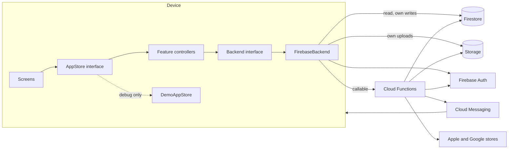
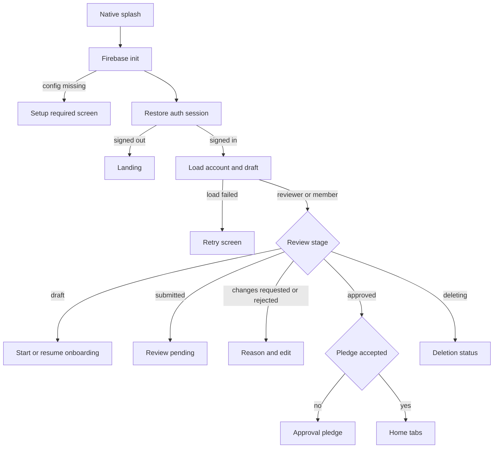
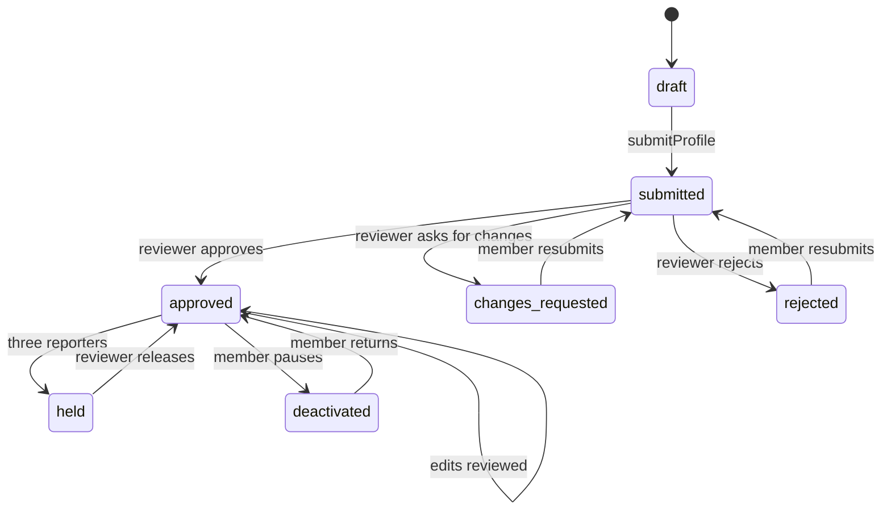
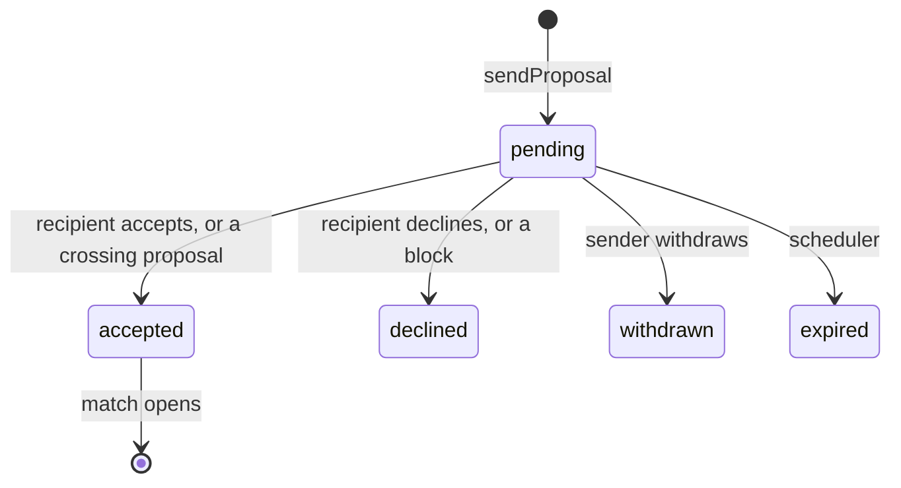

# Architecture

## System

**The rules:**

1. Every decision with consequences runs in a Cloud Function. Security rules are the
   boundary, and route guards are only for navigation.
2. A client writes only its own draft, read markers, journey step, answers, messages, and
   device tokens.
3. The server is the only source of truth for stage, claims, quotas, credits and
   entitlement.
4. Screens never touch Firebase. They talk to a controller; a controller talks to
   `Backend`.

## Flutter layers

| Layer | Location | Responsibility |
|---|---|---|
| Screens and widgets | `lib/screens`, `lib/widgets` | Rendering and local UI state |
| Feature controllers | `lib/features/*` | One `ChangeNotifier` per feature |
| Interface | `lib/providers/app_store.dart` | What screens see while they migrate to controllers |
| Production facade | `lib/providers/remote_app_store.dart` | Delegates to controllers |
| Demo | `lib/providers/demo_app_store.dart` | Debug-only local simulation, never in release |
| Backend interface | `lib/data/backend.dart` | The contract with the server |
| Implementation | `lib/data/firebase_backend.dart` | Firebase |
| Models | `lib/models` | Data and serialisation |

`lib/features` holds only what has been extracted. Files are not moved for their own sake.

## Backend

`functions/src/rules.ts` holds pure decision logic with no Firebase dependency, so each rule
has a unit test. The other modules hold Firebase code and call into it.

## Application start

## Profile lifecycle

The server snapshots a submission. Approval publishes that snapshot, never the live draft.

## Proposal to match

A match exists only through `openMatch`, called from a transaction after both sides have
acted. Every terminal state is final.

## Decisions

Recorded in `IMPLEMENTATION_ROADMAP.md`.
