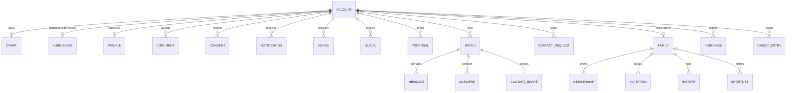

# Database Schema

The data dictionary for Firestore and Storage. **Writer** says who can change a document;
"server" means Cloud Functions only. Every collection keeps `createdAt` where a document is
created once, and `updatedAt` where it changes.

## Relationships

## Collections

| Path | Purpose | Reader | Writer | Retention |
|---|---|---|---|---|
| `config/app` | Limits, eligibility, plans | signed-in | console only | n/a |
| `drafts/{uid}` | Member's working profile | owner, reviewer | owner | deleted with account |
| `submissions/{uid}` | Reviewed snapshot with `version` | reviewer through functions | server | deleted with account |
| `accounts/{uid}` | Stage, quotas, entitlement, verified phone | owner | server | deleted with account |
| `accounts/{uid}/documents/{type}` | Verification state and paths | owner | server | files deleted on approval plus policy period |
| `accounts/{uid}/consents/{category}` | Policy version, timestamps, purpose | owner | server | kept per legal policy |
| `accounts/{uid}/notifications/{id}` | In-app notifications | owner | server, owner marks read | deleted with account |
| `accounts/{uid}/devices/{token}` | Push tokens | owner | owner | deleted with account |
| `accounts/{uid}/settings/{name}` | Privacy and notification choices | owner | owner, validated | deleted with account |
| `accounts/{uid}/blocks/{other}` | Blocks made | server | server | deleted with account, or kept hashed per policy |
| `accounts/{uid}/hidden/{other}` | "Don't show" | server | server | deleted with account |
| `accounts/{uid}/viewed/{other}` | Free view record | server | server | deleted with account |
| `profiles/{uid}` | Published card | owner, served through functions | server | deleted with account |
| `proposals/{from}_{to}` | Proposal state machine | the two people | server | deleted with account |
| `contactRequests/{from}_{to}` | Contact request state | the two people | server | deleted with account |
| `contactShares/{pair}` | Shared verified numbers | the pair | server | deleted on close |
| `matches/{pair}` | Match with counters | the pair | server, members set own read marker and journey step | see `FIREBASE_SECURITY.md` |
| `matches/{pair}/messages/{id}` | Messages | the pair while active | sender, server | see `FIREBASE_SECURITY.md` |
| `matches/{pair}/answers/{uid}` | Important Questions | participant after answering | owner | with the match |
| `family/{member}` | Circle summary | member, guardians | server | deleted with account |
| `family/{member}/memberships/{uid}` | Permissions and relationship | member, that guardian | server | deleted with account |
| `family/{member}/invitations/{id}` | Hashed code, phone hash, expiry, status | member | server | expires |
| `family/{member}/history/{id}` | Append-only permission history | member | server | minimal, per policy |
| `family/{member}/shortlist/{profile}` | Shared summaries | circle with permission | server | deleted with account |
| `familyLinks/{uid}/circles/{member}` | Circles a guardian belongs to | that guardian | server | deleted with account |
| `reports/{reporter}_{target}` | Structured report | reviewers through functions | server | per policy |
| `auditLogs/{id}` | Privileged action record | console only | server | per policy |
| `purchases/{sha256}` | One store transaction | owner | server | kept for payment obligations |
| `creditLedger/{id}` | Credit movements | owner | server | kept for payment obligations |
| `deletionRequests/{uid}` | Deletion job state, no personal data | owner | server | minimal completion record |
| `inviteCodes/{code}`, `inviteClaims/{uid}` | Member invites | server | server | removed with account |
| `rateLimits/{key}` | Short-lived counters | server | server | expire by TTL |

## Storage

| Path | Reader | Writer |
|---|---|---|
| `photos/{uid}/{file}` | owner | owner, create and delete, JPEG, PNG or WebP, under 10 MB |
| `published/{uid}/{photoId}` | server, viewers through signed URLs | server |
| `verification/{uid}/{type}/{file}` | server, reviewers through signed URLs | owner, create only, image or PDF, under 10 MB |

## Denormalisation

| Field | Source | Kept consistent by |
|---|---|---|
| `matches.lastMessage`, `lastMessageAt`, `unread` | messages | `onMessageCreated` trigger |
| `profiles.verified`, `verifiedDocs` | documents | `reviewDocument` |
| `profiles.reportCount`, `held` | reports | `reportProfile`, `resolveReport` |
| `family/.../shortlist` | profiles, frozen at share time | removed on account deletion |

## Indexes

All composite indexes are in `firebase/firestore.indexes.json`. A change to a query in
`functions/src` must include its index in the same commit.

## Migrations

No production data exists yet, so no data migration has been needed. Client draft fields
are additive and read with defaults. `WardProfile.fromDraft` maps the old step numbers to
the six-step flow.
