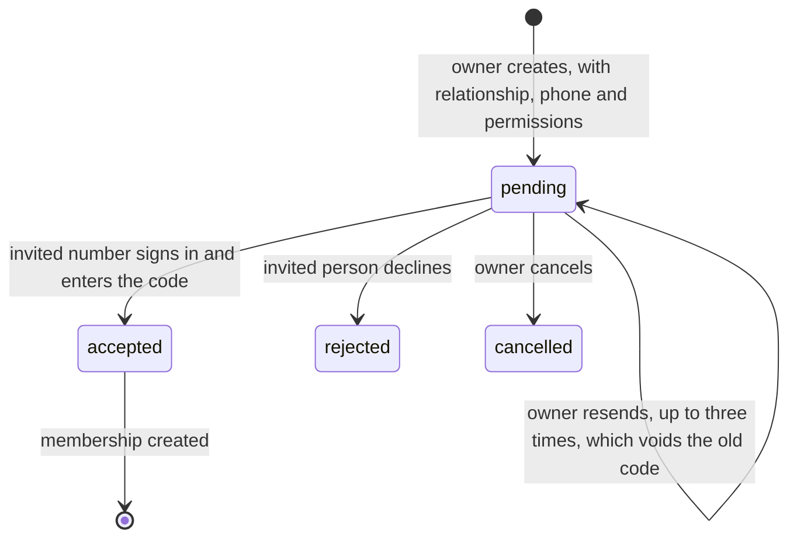
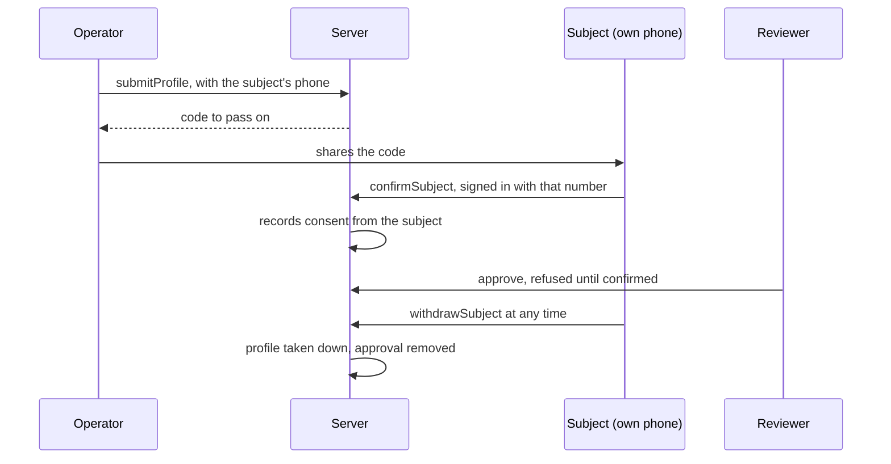

# Family Access Model

Family participation is optional. The owner of a profile decides who joins and what they can
do, and can remove anyone at any time.

## People

| Term | Meaning |
|---|---|
| Owner | The Firebase account that holds the profile. In self-managed mode, the person. In family-managed mode, the relative running the account (the operator). |
| Subject | The adult a family-managed profile is about. Has their own account and phone. |
| Guardian | A family member invited into a circle. Holds only the permissions granted. |

## Permissions

Only permissions with a real, server-enforced feature exist. Each is checked on every call.

| Permission | Allows | Enforced by |
|---|---|---|
| `view_shortlist` | See summaries the owner shared, and give an opinion | Firestore rule on `shortlist`, `giveFamilyOpinion` |
| `view_profile` | See a short summary of the owner's published profile | `familyOverview` |
| `view_proposals` | See pending proposals, as summaries | `familyOverview` |
| `manage_proposals` | Accept or decline a proposal for the owner. The owner is notified and the action is recorded | `familyRespondProposal` |

The brief's other examples (`edit_profile`, `send_proposals`, `view_matches`,
`manage_introductions`, `view_family_information`, `receive_notifications`) are not offered,
because no feature enforces them yet. A permission that does nothing would mislead the owner.

## What a guardian can never do

No permission grants any of these, and each has a test: read messages, read verification
documents, see contact details, act as the owner on any other callable, change their own
permissions, or keep access after removal. Firestore rules give guardians no path to
`matches`, `accounts`, `contactShares` or `drafts`.

## Invitation lifecycle

- The invitation is bound to one phone number. Sign-in proves that number by SMS.
- Codes and phone numbers are stored only as SHA-256 hashes.
- A code works once and expires after seven days. A wrong phone gets the same answer as a
  wrong code, so codes cannot be probed.
- Joining is limited to five attempts an hour per account.
- The app has no SMS provider, so the owner shares the code through their phone's share sheet.

## Family-managed profiles

A profile the subject refuses returns to the operator. The operator's tick box alone never
publishes a profile. Withdrawal does not need the operator.

## Revocation

Removal deletes the membership document. Firestore rules and callables read that document on
each request, so access ends at once. Shortlist summaries the guardian already saw on screen
cannot be recalled.

## History and retention

`family/{owner}/history` is append-only and readable only by the owner. It holds action names
and ids, never phone numbers. It is deleted with the account.

## Legal note

This model follows the brief's product rules. It has not been reviewed by a lawyer, and
guardianship rules differ between countries (blocker X-4).
